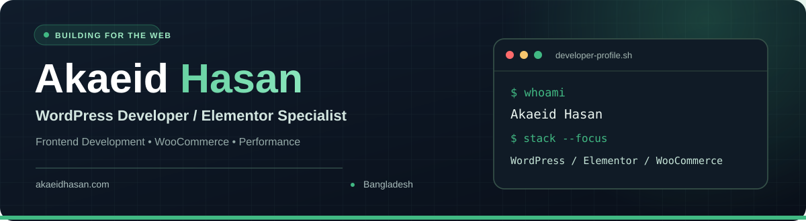

<!-- Akaeid Hasan | Official GitHub Profile README. Natural keyword-focused content and original public work. -->

  

  <h1>Hi, I'm Akaeid Hasan </h1>
  <h3>Front-End Web Developer | WordPress &amp; Elementor Specialist</h3>
  
<strong>WordPress Developer • Elementor &amp; WooCommerce • Responsive Web Design • Website Performance</strong>

  
Bangladesh &nbsp; | &nbsp; <a href="https://akaeidhasan.com/">akaeidhasan.com</a>

  
Building fast, responsive, user-friendly websites and practical WordPress solutions.

<!-- Download CV -->
  

  <!-- WhatsApp -->
  

  <!-- Visit Website -->
  

  <!-- Contact -->
  

  <!-- View Projects (fixed icon) -->
  

---

  
  
  
  
  
  

## About Akaeid Hasan

Hi, I’m **Akaeid Hasan,** a WordPress **Developer** specializing in building modern, fast, and fully responsive websites that help individuals and businesses grow online.

**I design and develop** user-friendly WordPress websites, **including portfolios, business websites, blogs, landing pages, and eCommerce stores.** My focus is always on clean design, mobile responsiveness, performance optimization, and a smooth user experience.

Alongside WordPress, I have working knowledge of **HTML, CSS, and JavaScript,** as well as experience working with other **popular CMS** platforms such as **Shopify, Wix, and Squarespace.** This allows me to adapt to different project requirements and deliver flexible solutions.

**Client satisfaction,** clear communication, and high-quality work are always my top priorities.

**What I focus on:** WordPress development, Elementor website design, Elementor Pro customization, WooCommerce stores, custom frontend interfaces, responsive landing pages, WordPress speed optimization, and practical website troubleshooting.

 

  

## What I Do

| WordPress & Elementor | WooCommerce |
| :--- | :--- |
| Custom WordPress websites, Elementor page designs, redesigns, landing pages, blogs, and portfolio websites. | WooCommerce store setup, product pages, shop layouts, responsive product grids, and storefront customization. |
| **Website Performance** | **Frontend Development** |
| WordPress speed optimization, responsive improvements, theme customization, and website maintenance. | HTML, CSS, JavaScript, Tailwind CSS, and interactive frontend components with an emphasis on usability. |

### More Services I Offer

From personal portfolios and business websites to custom e-commerce experiences, I help build, improve, and maintain practical websites with WordPress, Elementor, WooCommerce, Shopify, and frontend technologies.

| Website Design & Development | E-commerce, Optimization & Support |
| :--- | :--- |
| **WordPress Website Design & Development** | **WooCommerce / Shopify Store Setup** |
| **Website Customization & Redesign** | **E-commerce Development** |
| **Portfolio & Personal Websites** | **Speed Optimization & Mobile Responsiveness** |
| **Blog / News Websites** | **On-Page SEO** |
| **Booking, Real Estate, & Membership Websites** | **Multi-language Website Setup** |
| **Educational / LMS Websites** | **Website Security Setup** |
| **Landing Page Design** | **Website Migration** |

  

<strong>7 Days of Free Support</strong> after project completion to help with post-launch questions and minor adjustments.

### Development Approach

- **Discover:** Understand the website's purpose, audience, and user experience goals.
- **Build:** Create responsive layouts and functional WordPress or frontend solutions.
- **Optimize:** Focus on usability, performance, and maintainable implementation.
- **Improve:** Document work, troubleshoot problems, and continuously refine results.

## Featured Public Projects

Explore selected public repositories. These projects showcase real WordPress development and frontend work.

| Project | Description | Technologies |
| :--- | :--- | :--- |
| [**UploadShield — WordPress Plugin**](https://github.com/akaeid-hasan/upload-shield) | WordPress image upload size limit plugin with configurable restrictions for administrators and other users. | WordPress, PHP |
| [**Portfolio Website**](https://github.com/akaeid-hasan/Portfolio---Website) | Personal developer portfolio showcasing WordPress and frontend experience. | Web Development |
| [**Interactive Developer Resume**](https://github.com/akaeid-hasan/akaeidhasan-resume) | Responsive interactive resume with a [live preview](https://akaeid-hasan.github.io/akaeidhasan-resume/). | HTML, CSS, JavaScript |
| [**Modern Design Calculator**](https://github.com/akaeid-hasan/Modern-Design-Calculator) | Responsive calculator with real-time calculations and a clean dark interface. | HTML, Tailwind CSS, JavaScript |
| [**Digital Clock**](https://github.com/akaeid-hasan/Digital-Clock) | Real-time responsive digital clock built with vanilla JavaScript. | HTML, Tailwind CSS, JavaScript |
| [**JavaScript Tabs Component**](https://github.com/akaeid-hasan/MID-Exam-Tabs-Component) | Responsive tabs component with page-free section switching. | HTML, CSS, JavaScript |

  

## Technologies & Skills

  
  
  
  
  
  
   
  
  
  
  
  

### Skills Overview

| Skill | Progress |
| :--- | :--- |
| **WordPress** |  |
| **Elementor** |  |
| **WooCommerce** |  |
| **HTML** |  |
| **CSS** |  |
| **Tailwind CSS** |  |
| **JavaScript** |  |
| **React JS** |  |

> I primarily work with WordPress and Elementor, while continuing to strengthen my frontend development skills in JavaScript and React.

## WordPress Development & Specializations

| WordPress Development | Website & Frontend |
| :--- | :--- |
| WordPress website design and development | HTML, CSS, and JavaScript |
| Elementor and Elementor Pro customization | Responsive layout and UI design |
| WooCommerce website development | Tailwind CSS and Bootstrap |
| WordPress theme customization | Landing pages and business websites |
| WordPress troubleshooting and maintenance | Portfolio and interactive frontend projects |
| Website speed and performance optimization | User-friendly website experiences |

## Connect With Me

Looking for a WordPress Developer, Elementor Specialist, or a frontend developer to help with a website? Explore my work or get in touch through the links below.

<!-- 🌐 Connect with me -->

  <!-- Facebook -->
  

  <!-- Instagram -->
  

  <!-- Threads -->
  

  <!-- Twitter (X) -->
  

  <!-- Behance -->
  

  <!-- Blogger -->
  

  <!-- Gmail -->
  

  <!-- WhatsApp -->
  

**Portfolio:** [akaeidhasan.com](https://akaeidhasan.com/) &nbsp; | &nbsp; **GitHub:** [@akaeid-hasan](https://github.com/akaeid-hasan)

## GitHub Activity

---

## License

This project is licensed under the [CC BY-NC-ND 4.0](https://creativecommons.org/licenses/by-nc-nd/4.0/) license.

<strong>Thanks for visiting! ⭐</strong> Made with care by <a href="https://akaeidhasan.com/">Akaeid Hasan</a> · WordPress Developer &amp; Elementor Specialist

